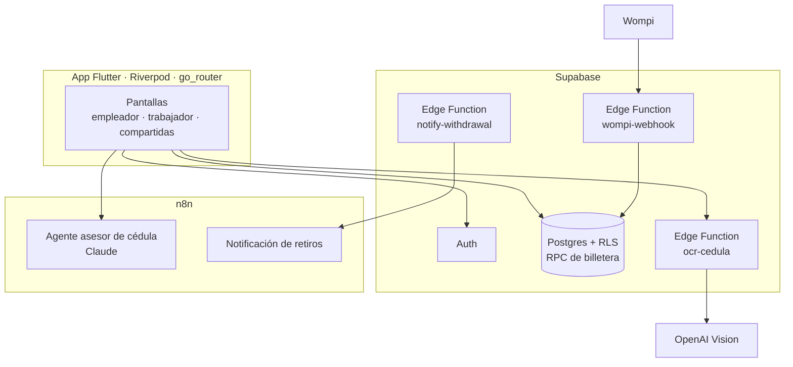

# InChamba

**Marketplace móvil de trabajos por días para Colombia.** Conecta a quien necesita una mano de obra puntual (cargue y descargue, mudanzas, apoyo logístico, oficios) con trabajadores verificados cerca, con pago seguro dentro de la app.


---

## El problema

En Colombia, conseguir trabajo por días o contratar a alguien para una tarea puntual depende de conocidos, grupos de WhatsApp y llamadas. El empleador no sabe si la persona es confiable. El trabajador no sabe si le van a pagar. Nadie tiene historial ni respaldo.

## La solución

Una app al estilo *InDrive*, pero para trabajo: el empleador publica una oferta, los trabajadores se postulan y **negocian el precio**, y el dinero queda respaldado en una billetera hasta que ambas partes confirman que el trabajo se hizo.

### Funcionalidades

| Para el empleador | Para el trabajador |
|---|---|
| Publicar ofertas con ubicación y precio | Feed de ofertas cercanas (geolocalización) |
| Recibir postulaciones y contraofertas | Postularse y negociar el precio |
| Pagar en línea con Wompi | Marcar avance y trabajo completado |
| Confirmar el trabajo y liberar el pago | Billetera con retiros |
| Calificar al trabajador | Calificar al empleador |

**Comunes:** mensajería en la app, notificaciones, disputas, perfiles con reputación y un modo invitado para explorar sin registrarse.

### Verificación de identidad con IA

Para generar confianza, cada usuario verifica su **cédula colombiana** con una foto:

- Una *Edge Function* (`ocr-cedula`) envía la imagen a un modelo de visión de OpenAI que **detecta si es el frente o el reverso** y extrae los datos en JSON estructurado.
- Un **asistente conversacional** (agente de n8n con Claude y memoria) guía al usuario cuando la foto no sirve.

## Arquitectura



El código sigue una **arquitectura limpia por capas**:

```
lib/
├── core/           Constantes, tema, errores, utilidades
├── domain/         Entidades del negocio
├── data/           Modelos y fuentes de datos (Supabase, HTTP)
└── presentation/
    ├── providers/  Estado con Riverpod
    ├── screens/
    │   ├── employer/   Crear oferta, pagos, billetera, confirmar trabajo
    │   ├── worker/     Feed, postulaciones, progreso, completar
    │   └── shared/     Cédula, mensajería, disputas, calificaciones, perfil
    └── widgets/
supabase/
├── functions/      Edge Functions (Deno/TypeScript)
└── migrations/     Esquema SQL versionado
n8n/                Workflows exportados
```

## Stack

- **Móvil:** Flutter 3, Dart, Riverpod + Hooks, go_router, Dio
- **Backend:** Supabase (Auth, Postgres, RLS, RPC, Edge Functions en Deno)
- **Pagos:** Wompi, con webhook que acredita la billetera
- **IA:** OpenAI Vision (OCR de cédula) y Claude vía n8n (asistente)
- **Extras:** geolocalización, notificaciones locales, voz a texto, grabación de audio

## Correr en local

```bash
flutter pub get
flutter run \
  --dart-define=SUPABASE_URL=https://<tu-proyecto>.supabase.co \
  --dart-define=SUPABASE_ANON_KEY=<tu-anon-key>
```

Las claves se inyectan en tiempo de compilación con `--dart-define`; ninguna vive en el repositorio.

---

Desarrollado por **[Samuel Alzate](https://github.com/Samuel3945)** · Cartagena, Colombia
